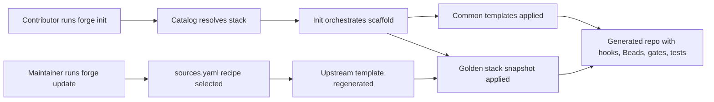

# forge

`forge` is a Go CLI that turns an empty directory into a fully configured, AI-native project with git, agent instructions, Beads, guard hooks, quality gates, and an initial walking skeleton.

This repository is the generator itself. It owns the embedded templates, stack snapshots, security floor, gate pipeline, and maintainer refresh workflow.

## What It Generates

V1 ships twelve stacks across four languages:

| Language | Project Type | Stack Key |
|---|---|---|
| Go | CLI | `go-cli-cobra` |
| Go | API | `go-api-chi` |
| Go | fullstack | `go-web-templ` (templ + HTMX) |
| Python | CLI | `python-cli-typer` |
| Python | API | `python-fastapi` |
| Python | fullstack | `python-web-jinja` (FastAPI + Jinja2 + HTMX) |
| C# | CLI | `csharp-cli` |
| C# | API | `csharp-webapi` |
| C# | fullstack | `csharp-blazor` (Blazor Web App, Interactive Auto) |
| TypeScript | frontend | `vite-ts` (Vite vanilla-ts, prescribed src/ layout) |
| TypeScript | frontend | `sveltekit` |
| TypeScript | frontend | `angular` (standalone + signals) |

The api stacks also accept `--project-type fullstack` plus `--frontend
vite-ts|sveltekit|angular`, composing the chosen frontend under `web/` wired to the
backend's `/health`. The TypeScript stacks scaffold standalone frontend repos whose typed
API client points at `--api-base-url` (a third-party API or an existing backend).

Each shipped stack is expected to scaffold a repo that can run `mise install` and `mise run ci` with at least one real passing test.

Every stack's overlay also ships an env-gated OpenTelemetry bootstrap (traces + metrics) with a real test: providers are always installed, and OTLP/HTTP export turns on only when `OTEL_EXPORTER_OTLP_ENDPOINT` is set (see ADR-0020). Every repo also ships a `mise run otel` task that starts the shared, system-wide Collector + Aspire Dashboard stack, points OTLP endpoints at the Collector under `mise`, and exposes the local viewer at `http://127.0.0.1:18888` (see ADR-0021 and ADR-0022).

## Dependency and Language Audit

Last checked: 2026-10-30. “Before audit” records declarations shipped before this change;
“Current declaration” records the post-upgrade repository state. Ranges are declarations, not
installed versions. `sources.yaml` captures scaffolder provenance, not application dependency
locks. Frontend overlay manifests win over base manifests in `internal/scaffold.Writer.Write`;
both are cataloged where declarations differ. New defaults affect new scaffolds; `forge upgrade`
propagates only owned common infrastructure files, not application dependencies, stack pins, or
generated CI.

The audit updated generator modules; Go, Python, .NET, and frontend templates; scaffolder snapshots;
shared images; CI actions; and infrastructure version 9. The verification record distinguishes
passed gates from checks blocked by host state; package-manager ranges and unpinned transitive
graphs are not lockfiles.

### Languages, runtimes, and scaffolders

| Component | Used by / declaration source | Before audit | Current declaration | Latest stable checked | Status / compatibility note | Upstream evidence |
|---|---|---:|---:|---:|---|---|
| Go generator | `go.mod` | `1.26.2` | `1.27.3` | `1.27.3` | Applied; prompt, build, and focused CLI tests passed. Full suite hit local canonical-guide drift and private APM bootstrap constraints (verification record). | [Go releases](https://go.dev/dl/?mode=json) |
| Go generated stacks | Three Go `go.mod.tmpl` files and overlay mise files | `1.26.8` | `1.27.3` | `1.27.3` | All three generated Go stack CI gates passed with govulncheck after adding the `x/net` security fix described below. | [Go releases](https://go.dev/dl/?mode=json) |
| Python | Three Python overlay mise files; package floor remains `requires-python = ">=3.12"` | `3.14.4` | `3.15.2` | `3.15.2` | All three Python stacks and all three Python-backend compositions passed real tests, lint, typecheck, coverage, and pip-audit under Python 3.15.2. | [Python 3.15.2](https://www.python.org/downloads/release/python-3152/) |
| .NET SDK / C# compiler | Three C# overlay mise files and SDK recipe captures; TFM stays `net10.0` | SDK `10.0.203` | SDK `10.0.403`; TFM `net10.0` | `10.0.403` | All three C# stacks and compositions passed VSTest, including named xUnit v3 tests and coverage collection. | [.NET 10](https://dotnet.microsoft.com/en-us/download/dotnet/10.0) |
| Node.js | Three frontend overlays and conditional declarations in three API backend overlays | `"24"` | `26.13.0` | `26.13.0` | All three standalone frontends and nine compositions passed gates; production builds passed for standalone frontends and compositions. | [Node release metadata](https://nodejs.org/dist/index.json) |
| npm | Angular base `packageManager` | `npm@10.9.7` | `npm@11.20.0` | bundled `npm@11.20.0`; independent `npm@12.2.1` exists | Exercised selected bundled npm; no standalone npm installer. | [Node metadata](https://nodejs.org/dist/index.json), [npm](https://registry.npmjs.org/npm/latest) |
| TypeScript | Effective Vite / Svelte / Angular overlays and base manifests | `~6.0.2` / `^6.0.3` / `~5.9.2` | `~6.0.3` in all three | `~6.0.3` selected; latest `7.0.2` is peer-blocked by Angular 22 and typescript-eslint `<6.1` | All three framework gates and builds passed with TypeScript `6.0.3`. | [TypeScript 6.0.3](https://registry.npmjs.org/typescript/6.0.3), [Angular compatibility](https://angular.dev/reference/versions) |
| Cobra scaffolder | `sources.yaml` | `v1.3.0` | `v1.3.0` | `v1.3.0` | Current; source commit and capture remain unchanged. | [Cobra CLI](https://api.github.com/repos/spf13/cobra-cli/releases/latest) |
| uv scaffolder | Python recipe captures in `sources.yaml` | CLI/API `0.11.8`; Jinja `0.8.17` | `uv 0.13.6` in all three; captured `2026-10-30` | `0.13.6` | Recipe comparisons confirmed all three source snapshots changed; handwritten package layout and telemetry calls were retained. | [uv 0.13.6](https://github.com/astral-sh/uv/releases/tag/0.13.6) |
| create-vite scaffolder | Vite recipe in `sources.yaml` | `8.1.1` | `9.3.3`; captured `2026-10-30` | `9.3.3` | Native recipe command passed; standalone and composed Vite gates/builds passed. | [create-vite](https://registry.npmjs.org/create-vite/latest) |
| Svelte scaffolder | Svelte recipe in `sources.yaml` | `sv@0.16.2` | `sv@1.1.1`; captured `2026-10-30` | `sv@1.1.1` | Native recipe command passed; SvelteKit 3 package imports and production builds passed. | [sv](https://registry.npmjs.org/sv/latest) |
| Angular scaffolder | Angular recipe in `sources.yaml` | `21.2.19` | `@angular/cli 22.2.5`; captured `2026-10-30` | `22.2.5` | Native recipe command passed; standalone and composed CI/builds passed. | [Angular CLI](https://registry.npmjs.org/@angular%2fcli/latest) |

### Generator Go modules

Rows below preserve the root `go.mod` requirements before this upgrade; `Current declaration`
records each requirement’s actual post-tidy disposition. New-path modules and resolver-selected
indirect requirements are listed below. Go proxy `@latest` records are used unless another source is linked.

| Component | Used by / declaration source | Before audit | Current declaration | Latest stable checked | Status / compatibility note | Upstream evidence |
|---|---|---:|---:|---:|---|---|
| `github.com/atotto/clipboard` | Generator `go.mod` | `v0.1.4` | `v0.1.4` (indirect) | `v0.1.4` | Unchanged and retained by resolver. | [proxy](https://proxy.golang.org/github.com/atotto/clipboard/@latest) |
| `github.com/aymanbagabas/go-osc52/v2` | Generator `go.mod` | `v2.0.1` | Removed by `go mod tidy` | `v2.0.1` | No longer reachable after Huh v2 migration. | [proxy](https://proxy.golang.org/github.com/aymanbagabas/go-osc52/v2/@latest) |
| `github.com/catppuccin/go` | Generator `go.mod` | `v0.3.0` | `v0.3.0` (indirect) | `v0.3.0` | Unchanged and retained by resolver. | [proxy](https://proxy.golang.org/github.com/catppuccin/go/@latest) |
| `github.com/charmbracelet/bubbles` | Generator `go.mod` | `v0.21.1-0.20250623103423-23b8fd6302d7` | Removed; `charm.land/bubbles/v2 v2.2.1` selected | `v1.0.0` | Huh v2 uses the new module path. | [old proxy](https://proxy.golang.org/github.com/charmbracelet/bubbles/@latest), [new proxy](https://proxy.golang.org/charm.land/bubbles/v2/@latest) |
| `github.com/charmbracelet/bubbletea` | Generator `go.mod` | `v1.3.6` | Removed; `charm.land/bubbletea/v2 v2.1.1` selected | `v1.3.10` | Huh v2 uses the new module path. | [old proxy](https://proxy.golang.org/github.com/charmbracelet/bubbletea/@latest), [new proxy](https://proxy.golang.org/charm.land/bubbletea/v2/@latest) |
| `github.com/charmbracelet/colorprofile` | Generator graph | `v0.2.3-0.20250311203215-f60798e515dc` | `v0.4.3` (indirect) | `v0.4.3` | Resolver-selected. | [proxy](https://proxy.golang.org/github.com/charmbracelet/colorprofile/@latest) |
| Huh | Generator and `cmd/forge` imports | `github.com/charmbracelet/huh v1.0.0` | `charm.land/huh/v2 v2.0.3` (direct) | `v2.0.3` | Path migration; prompt defaults, select/text flow, and abort behavior preserved. | [Huh v2](https://proxy.golang.org/charm.land/huh/v2/@latest) |
| `github.com/charmbracelet/lipgloss` | Generator graph | `v1.1.0` | Removed; `charm.land/lipgloss/v2 v2.0.6` selected | `v1.1.0` | Huh v2 uses the new module path. | [old proxy](https://proxy.golang.org/github.com/charmbracelet/lipgloss/@latest), [new proxy](https://proxy.golang.org/charm.land/lipgloss/v2/@latest) |
| `github.com/charmbracelet/x/ansi` | Generator graph | `v0.9.3` | `v0.11.9` (indirect) | `v0.11.9` | Upgraded by resolver. | [proxy](https://proxy.golang.org/github.com/charmbracelet/x/ansi/@latest) |
| `github.com/charmbracelet/x/cellbuf` | Generator `go.mod` | `v0.0.13` | Removed by `go mod tidy` | `v0.0.15` | No longer reachable. | [proxy](https://proxy.golang.org/github.com/charmbracelet/x/cellbuf/@latest) |
| `github.com/charmbracelet/x/exp/strings` | Generator `go.mod` | `v0.0.0-20240722160745-212f7b056ed0` | `v0.1.0` (indirect) | `v0.1.0` | Upgraded by resolver. | [proxy](https://proxy.golang.org/github.com/charmbracelet/x/exp/strings/@latest) |
| `github.com/charmbracelet/x/term` | Generator graph | `v0.2.1` | `v0.2.2` (indirect) | Resolver-selected `v0.2.2` | Proxy origin reports `main`; not an independently verified release tag. | [proxy](https://proxy.golang.org/github.com/charmbracelet/x/term/@latest) |
| `github.com/dustin/go-humanize` | Generator graph | `v1.0.1` | `v1.1.0` (indirect) | `v1.1.0` | Upgraded by resolver. | [proxy](https://proxy.golang.org/github.com/dustin/go-humanize/@latest) |
| `github.com/erikgeiser/coninput` | Generator `go.mod` | `v0.0.0-20211004153227-1c3628e74d0f` | Removed by `go mod tidy` | No newer version found | No longer reachable. | [proxy](https://proxy.golang.org/github.com/erikgeiser/coninput/@latest) |
| `github.com/lucasb-eyer/go-colorful` | Generator graph | `v1.2.0` | `v1.4.1` (indirect) | `v1.4.1` | Upgraded by resolver. | [proxy](https://proxy.golang.org/github.com/lucasb-eyer/go-colorful/@latest) |
| `github.com/mattn/go-isatty` | Generator `go.mod` | `v0.0.20` | `v0.0.24` (direct) | `v0.0.24` | Direct requirement after tidy. | [proxy](https://proxy.golang.org/github.com/mattn/go-isatty/@latest) |
| `github.com/mattn/go-localereader` | Generator `go.mod` | `v0.0.1` | Removed by `go mod tidy` | `v0.0.1` | No longer reachable. | [proxy](https://proxy.golang.org/github.com/mattn/go-localereader/@latest) |
| `github.com/mattn/go-runewidth` | Generator graph | `v0.0.16` | `v0.0.31` (indirect) | `v0.0.31` | Upgraded by resolver. | [proxy](https://proxy.golang.org/github.com/mattn/go-runewidth/@latest) |
| `github.com/mitchellh/hashstructure/v2` | Generator `go.mod` | `v2.0.2` | `v2.0.2` (indirect) | `v2.0.2` | Unchanged and retained by resolver. | [proxy](https://proxy.golang.org/github.com/mitchellh/hashstructure/v2/@latest) |
| `github.com/muesli/ansi` | Generator `go.mod` | `v0.0.0-20230316100256-276c6243b2f6` | Removed by `go mod tidy` | No newer version found | No longer reachable. | [proxy](https://proxy.golang.org/github.com/muesli/ansi/@latest) |
| `github.com/muesli/cancelreader` | Generator `go.mod` | `v0.2.2` | `v0.2.2` (indirect) | `v0.2.2` | Unchanged and retained by resolver. | [proxy](https://proxy.golang.org/github.com/muesli/cancelreader/@latest) |
| `github.com/muesli/termenv` | Generator `go.mod` | `v0.16.0` | Removed by `go mod tidy` | `v0.16.0` | No longer reachable. | [proxy](https://proxy.golang.org/github.com/muesli/termenv/@latest) |
| `github.com/rivo/uniseg` | Generator `go.mod` | `v0.4.7` | `v0.4.7` (indirect) | `v0.4.7` | Unchanged and retained by resolver. | [proxy](https://proxy.golang.org/github.com/rivo/uniseg/@latest) |
| `github.com/xo/terminfo` | Generator graph | `v0.0.0-20220910002029-abceb7e1c41e` | `v1.3.0` (indirect) | `v1.3.0` | Upgraded by resolver. | [proxy](https://proxy.golang.org/github.com/xo/terminfo/@latest) |
| `golang.org/x/sync` | Generator graph | `v0.15.0` | `v0.24.0` (indirect) | `v0.24.0` | Upgraded by resolver. | [proxy](https://proxy.golang.org/golang.org/x/sync/@latest) |
| `golang.org/x/sys` | Generator graph | `v0.33.0` | `v0.49.0` (indirect) | `v0.49.0` | Upgraded by resolver. | [proxy](https://proxy.golang.org/golang.org/x/sys/@latest) |
| `golang.org/x/text` | Generator `go.mod` | `v0.23.0` | Removed by `go mod tidy` | `v0.43.0` | No longer reachable. | [proxy](https://proxy.golang.org/golang.org/x/text/@latest) |
| YAML | Generator and tests | `gopkg.in/yaml.v3 v3.0.1` | `go.yaml.in/yaml/v3 v3.0.5` (direct) | `v3.0.5` | Moved to maintained module path; YAML behavior tests pass. | [proxy](https://proxy.golang.org/go.yaml.in/yaml/v3/@latest) |

### Generated Go stacks and shared web assets

| Component | Used by / declaration source | Before audit | Current declaration | Latest stable checked | Status / compatibility note | Upstream evidence |
|---|---|---:|---:|---:|---|---|
| Cobra | CLI Go manifest and `sources.yaml` seed | `v1.9.1` | `v1.10.2` | `v1.10.2` | Updated CLI manifest; generated CLI gate passed. | [proxy](https://proxy.golang.org/github.com/spf13/cobra/@latest) |
| pflag / mousetrap | CLI Go transitive modules | `pflag v1.0.6`; mousetrap `v1.1.0` | `pflag v1.0.10`; mousetrap `v1.1.0` | Same | Resolver-selected; CLI gate passed. | [pflag](https://proxy.golang.org/github.com/spf13/pflag/@latest), [mousetrap](https://proxy.golang.org/github.com/inconshreveable/mousetrap/@latest) |
| Chi | API `v5.1.0`; web `v5.3.1` | Same | `v5.5.0` both | `v5.5.0` | Updated both generated Go manifests; API and web gates passed. | [proxy](https://proxy.golang.org/github.com/go-chi/chi/v5/@latest) |
| Viper / Testify / Zap | API seed | `v1.19.0` / `v1.9.0` / `v1.27.0` | `v1.21.0` / `v1.12.1` / `v1.28.0` | Same | Updated API seed libraries; API gate passed. | [Viper](https://proxy.golang.org/github.com/spf13/viper/@latest), [Testify](https://proxy.golang.org/github.com/stretchr/testify/@latest), [Zap](https://proxy.golang.org/go.uber.org/zap/@latest) |
| go-cmp | All Go stack manifests | `v0.7.0` | `v0.7.0` | `v0.7.0` | Current. | [proxy](https://proxy.golang.org/github.com/google/go-cmp/@latest) |
| templ | Web manifest, mise CLI, recipe, and committed Go output | `v0.3.1020` | `v0.3.1100` | `v0.3.1100` | Updated manifest and recipe; regenerated committed Go output; web gate passed. | [proxy](https://proxy.golang.org/github.com/a-h/templ/@latest) |
| OpenTelemetry Go core | Go CLI/API/web manifests: `go.opentelemetry.io/otel`, `go.opentelemetry.io/otel/metric`, `go.opentelemetry.io/otel/trace`, `go.opentelemetry.io/otel/sdk`, `go.opentelemetry.io/otel/sdk/metric`, `go.opentelemetry.io/otel/exporters/otlp/otlpmetric/otlpmetrichttp`, `go.opentelemetry.io/otel/exporters/otlp/otlptrace/otlptracehttp` | `v1.46.0` each | `v1.47.0` each | `v1.47.0` each | Updated coherently; all three generated Go gates passed. | [module proxy](https://proxy.golang.org/go.opentelemetry.io/otel/@latest) |
| OpenTelemetry Go contrib | Go CLI/API/web runtime `go.opentelemetry.io/contrib/instrumentation/runtime`; API/web HTTP `go.opentelemetry.io/contrib/instrumentation/net/http/otelhttp` | `v0.71.0` | `v0.72.0` | `v0.72.0` | Updated runtime and HTTP together; all generated Go gates passed. | [runtime](https://proxy.golang.org/go.opentelemetry.io/contrib/instrumentation/runtime/@latest), [HTTP](https://proxy.golang.org/go.opentelemetry.io/contrib/instrumentation/net/http/otelhttp/@latest) |
| HTMX | Go web and Python Jinja local assets | `2.0.10` | `4.0.0` | `4.0.0` | Replaced with official core minified distributions; local URL and health-fragment behavior retained; web/Jinja gates passed. | [release](https://api.github.com/repos/bigskysoftware/htmx/releases/latest), [changelog](https://raw.githubusercontent.com/bigskysoftware/htmx/v4.0.0/CHANGELOG.md) |
| `golang.org/x/net` | Generated Go stack indirect requirement | Resolver-selected before audit | `v0.60.0` (indirect) | `v0.60.0` | Explicitly selected after govulncheck identified a fix; all three Go stack gates passed. | [proxy](https://proxy.golang.org/golang.org/x/net/@latest) |

### Python packages

| Component | Used by / declaration source | Before audit | Current declaration | Latest stable checked | Status / compatibility note | Upstream evidence |
|---|---|---:|---:|---:|---|---|
| Hatchling | Three Python build systems | Unbounded `hatchling` | `hatchling>=1.33.0` | `>=1.33.0` selected | Added supported lower bound; all Python gates passed. | [PyPI](https://pypi.org/pypi/hatchling/json) |
| Typer | Python CLI runtime | `>=0.12,<1.0` | `>=0.27.3,<1.0` | Same | Updated; CLI gate passed. | [PyPI](https://pypi.org/pypi/typer/json) |
| FastAPI | API and Jinja runtime | `>=0.111,<1.0` | `>=0.162.0,<1.0` | Same | Updated; API and Jinja gates passed. | [PyPI](https://pypi.org/pypi/fastapi/json) |
| Uvicorn standard | API and Jinja runtime | `>=0.30,<1.0` | `uvicorn[standard]>=0.54.0,<1.0` | Same | Added standard extras; both gates passed. | [PyPI](https://pypi.org/pypi/uvicorn/json) |
| Jinja2 | Jinja runtime | `>=3.1,<4.0` | `>=3.1.6,<4.0` | Same | Updated; Jinja gate passed. | [PyPI](https://pypi.org/pypi/jinja2/json) |
| OpenTelemetry distro | All Python runtime manifests | `~=0.65b0` | `>=0.66b2,<0.67` | Same | Updated beta family; all Python telemetry tests passed. | [PyPI](https://pypi.org/pypi/opentelemetry-distro/json) |
| OpenTelemetry HTTP exporter | All Python runtime manifests | `~=1.44` | `>=1.45.2,<1.46` | Same | Stable exporter aligned with beta instrumentation; tests passed. | [PyPI](https://pypi.org/pypi/opentelemetry-exporter-otlp-proto-http/json) |
| OpenTelemetry FastAPI instrumentation | API and Jinja | `~=0.65b0` | `>=0.66b2,<0.67` | Same | Updated beta; wrapper and duplicate-instrumentation guard retained. | [PyPI](https://pypi.org/pypi/opentelemetry-instrumentation-fastapi/json) |
| HTTPX2 | API dev | `>=2.0,<3.0` | `>=2.16.0,<3.0` | Same | Updated; API tests passed. | [PyPI](https://pypi.org/pypi/httpx2/json) |
| HTTPX / HTTPX2 | Jinja dev | `httpx>=0.27,<1.0` | `httpx2>=2.16.0,<3.0` | HTTPX2 `>=2.16.0,<3.0` | Removed HTTPX; HTTPX2 is required by Starlette TestClient; Jinja tests passed. | [HTTPX](https://pypi.org/pypi/httpx/json), [HTTPX2](https://pypi.org/pypi/httpx2/json), [Starlette TestClient](https://raw.githubusercontent.com/Kludex/starlette/main/starlette/testclient.py) |
| pytest | All dev groups | `>=8.2,<9.0` | `>=9.2.0,<10.0` | Same | Updated; all Python tests passed. | [PyPI](https://pypi.org/pypi/pytest/json) |
| pytest-cov | All dev groups | `>=5.0,<6.0` | `>=7.1.0,<8.0` | Same | Updated; no subprocess coverage feature is shipped. | [PyPI](https://pypi.org/pypi/pytest-cov/json) |
| pytest-mock | All dev groups | `>=3.14,<4.0` | `>=3.17.0,<4.0` | Same | Updated; all Python tests passed. | [PyPI](https://pypi.org/pypi/pytest-mock/json) |

No Python lockfile is shipped. The three standalone Python stacks and all three Python-backend
compositions passed real tests, lint, typecheck, coverage, and pip-audit; resolved transitive
versions remain installer-selected and are not pinned by the generated repositories.

### .NET packages

| Component | Used by / declaration source | Before audit | Current declaration | Latest stable checked | Status / compatibility note | Upstream evidence |
|---|---|---:|---:|---:|---|---|
| `System.CommandLine` | CLI runtime and recipe | `2.0.0-beta4.22272.1` | `2.0.14` | `2.0.14` | Replaced beta; CLI gate passed. | [NuGet](https://api.nuget.org/v3-flatcontainer/system.commandline/index.json) |
| `Microsoft.Extensions.DependencyInjection` | CLI/API/Blazor runtime projects | `10.0.12` | `10.0.14` | `10.0.14` | Updated; all C# gates passed. | [NuGet](https://api.nuget.org/v3-flatcontainer/microsoft.extensions.dependencyinjection/index.json) |
| Blazor WebAssembly server/client | `Microsoft.AspNetCore.Components.WebAssembly.Server` and `.WebAssembly` | `10.0.0` | `10.0.14` both | `10.0.14` | Kept client/server versions identical; Blazor gate passed. | [server](https://api.nuget.org/v3-flatcontainer/microsoft.aspnetcore.components.webassembly.server/index.json), [client](https://api.nuget.org/v3-flatcontainer/microsoft.aspnetcore.components.webassembly/index.json) |
| `Swashbuckle.AspNetCore` | Web API runtime | `6.6.2` | `10.3.1` | `10.3.1` | Swagger document and UI retained; Web API gate passed. | [NuGet](https://api.nuget.org/v3-flatcontainer/swashbuckle.aspnetcore/index.json) |
| OpenTelemetry .NET runtime packages | `OpenTelemetry.Exporter.OpenTelemetryProtocol`, `OpenTelemetry.Extensions.Hosting`, `OpenTelemetry.Instrumentation.Runtime`, `OpenTelemetry.Instrumentation.AspNetCore`, `OpenTelemetry.Instrumentation.Http` in CLI/API/Blazor runtime projects | `1.18.0` each | `1.20.1` each | `1.20.1` | Updated coherently; all C# gates passed. | [NuGet index](https://api.nuget.org/v3-flatcontainer/opentelemetry.exporter.opentelemetryprotocol/index.json) |
| `OpenTelemetry.Exporter.InMemory` | All three C# test projects | `1.18.0` | `1.20.1` | `1.20.1` | Updated with runtime OpenTelemetry; tests passed. | [NuGet](https://api.nuget.org/v3-flatcontainer/opentelemetry.exporter.inmemory/index.json) |
| `Microsoft.NET.Test.Sdk` | All test projects | `17.10.0` | `18.11.0` | `18.11.0` | Retained VSTest; all C# tests passed. | [NuGet](https://api.nuget.org/v3-flatcontainer/microsoft.net.test.sdk/index.json) |
| `coverlet.collector` | All test projects | `6.0.2` | `10.1.0` | `10.1.0` | Retained VSTest; collector remains incompatible with MTP v2. | [NuGet](https://api.nuget.org/v3-flatcontainer/coverlet.collector/index.json) |
| `NSubstitute` | All test projects | `5.1.0` | `6.2.0` | `6.2.0` | Updated; all C# tests passed. | [NuGet](https://api.nuget.org/v3-flatcontainer/nsubstitute/index.json) |
| xUnit | All test projects | `xunit 2.9.0` | `xunit.v3.mtp-off 4.0.2` | `xunit.v3 4.0.2` | Migrated package identity; named VSTest tests and coverage collection passed. | [migration](https://xunit.net/docs/getting-started/v3/migration), [NuGet](https://api.nuget.org/v3-flatcontainer/xunit.v3/index.json) |
| `xunit.runner.visualstudio` | All test projects | `2.8.2` | `4.0.1` | `4.0.1` | Updated; retain VSTest. | [NuGet](https://api.nuget.org/v3-flatcontainer/xunit.runner.visualstudio/index.json) |
| `StyleCop.Analyzers` | C# projects | `1.2.0-beta.556` | `1.2.0-beta.556` | Stable `1.1.118` is older; `1.3.151-beta` is prerelease | Retained existing beta; C# gates passed. | [NuGet](https://api.nuget.org/v3-flatcontainer/stylecop.analyzers/index.json) |

The .NET projects retain `net10.0`; SDK `10.0.403` built all three standalone C# stacks and
all three C#-backend compositions. Tests ran under VSTest, not Microsoft.Testing.Platform v2.

### Frontend packages

Versions below reflect the effective `.forge-overlay/package.json.tmpl` declarations where an
overlay exists; base manifests are also updated so provenance is not stale. Ranges are intentional.

| Component | Used by / declaration source | Before audit | Current declaration | Latest stable checked | Status / compatibility note | Upstream evidence |
|---|---|---:|---:|---:|---|---|
| Vite | Vite and Svelte overlays and base manifests | `^8.1.1` / `^8.0.16` | `^8.3.5` | Same | Updated; standalone and composed frontend gates/builds passed. | [npm](https://registry.npmjs.org/vite/latest) |
| Vitest | Vite/Svelte and Angular | `^4.1.10` / `^4.0.8` | `^5.0.5` | Same | Updated; all frontend tests passed. | [npm](https://registry.npmjs.org/vitest/latest) |
| SvelteKit | Svelte overlay and base manifest | `^2.63.0` | `^3.1.1` | Same | Migrated removed `$lib` alias to `#lib`; check and production builds passed. `npm ls` also reports generated extraneous `$app` and `yaml@2.9.1` entries after `svelte-kit sync`. | [npm](https://registry.npmjs.org/%40sveltejs%2Fkit/latest), [migration](https://svelte.dev/docs/kit/migrating-to-sveltekit-3) |
| Svelte adapters/plugin/runtime/check/lint | `@sveltejs/adapter-auto`, `@sveltejs/vite-plugin-svelte`, `svelte`, `svelte-check`, `eslint-plugin-svelte` | `^7.0.1`, `^7.1.2`, `^5.56.1`, `^4.6.0`, `^3.20.0` | `^8.0.0`, `^7.3.1`, `^5.57.3`, `^4.7.7`, `^3.23.1` | Same | Updated compatible Svelte 5 toolchain; standalone and composed gates/builds passed. | [adapter](https://registry.npmjs.org/%40sveltejs%2Fadapter-auto/latest), [SvelteKit plugin](https://registry.npmjs.org/%40sveltejs%2Fvite-plugin-svelte/latest), [Svelte](https://registry.npmjs.org/svelte/latest), [check](https://registry.npmjs.org/svelte-check/latest), [ESLint plugin](https://registry.npmjs.org/eslint-plugin-svelte/latest) |
| Angular runtime/compiler | `@angular/common`, `@angular/compiler`, `@angular/core`, `@angular/forms`, `@angular/platform-browser`, `@angular/router`, `@angular/compiler-cli` | `^21.2.0` each | `^22.2.4` each | Same | Updated as a framework set; standalone and composed gates/builds passed. | [Angular core](https://registry.npmjs.org/%40angular%2Fcore/latest), [compatibility](https://angular.dev/reference/versions) |
| Angular build/CLI | `@angular/build`, `@angular/cli` | `^21.2.19` each | `^22.2.5` each | Same | Updated builders/CLI; gates and production builds passed. | [build](https://registry.npmjs.org/%40angular%2Fbuild/latest), [CLI](https://registry.npmjs.org/%40angular%2Fcli/latest) |
| angular-eslint | Angular | `^21.1.0` | `^22.6.0` | Same | Updated; Angular gates passed. | [npm](https://registry.npmjs.org/angular-eslint/latest) |
| `rxjs` / `tslib` | Angular | `~7.8.0` / `^2.3.0` | `~7.8.2` / `^2.9.1` | Same | Preserved RxJS tilde convention; Angular tests passed. | [RxJS](https://registry.npmjs.org/rxjs/latest), [tslib](https://registry.npmjs.org/tslib/latest) |
| `jsdom` | Angular tests | `^28.0.0` | `^30.1.3` | Same | Updated; Angular tests passed. | [npm](https://registry.npmjs.org/jsdom/latest) |
| ESLint core | `@eslint/js`, `eslint` | `^9.39.0` each | `^10.0.1`, `^10.14.0` | Same | Updated; all frontend lint gates passed. | [@eslint/js](https://registry.npmjs.org/%40eslint%2Fjs/latest), [eslint](https://registry.npmjs.org/eslint/latest) |
| `typescript-eslint` | Frontend lint | `^8.63.0` | `^8.72.1` | Same | Updated; TypeScript 7 remains peer-blocked by Angular 22 and the current typescript-eslint peer range. | [npm](https://registry.npmjs.org/typescript-eslint/latest) |
| `globals` | Vite and Svelte | `^17.7.0` | `^17.13.0` | Same | Updated. | [npm](https://registry.npmjs.org/globals/latest) |
| Prettier | Vite/Svelte and Angular | `^3.9.5` / `^3.8.1` | `^3.9.10` | Same | Updated; formatting gates passed. | [npm](https://registry.npmjs.org/prettier/latest) |
| `prettier-plugin-svelte` | Svelte | `^4.1.1` | `^4.1.1` | `^4.1.1` | Current. | [npm](https://registry.npmjs.org/prettier-plugin-svelte/latest) |
| OpenTelemetry API/core | All three frontend stacks | API `^1.9.1`; core not direct | API `^1.10.0`; core `^3.0.0` | Same | Added direct core dependency for explicit W3C propagators; frontend telemetry tests passed. | [API](https://registry.npmjs.org/%40opentelemetry%2Fapi/latest), [core](https://registry.npmjs.org/%40opentelemetry%2Fcore/latest) |
| OpenTelemetry exporters/instrumentation | `@opentelemetry/exporter-metrics-otlp-http`, `@opentelemetry/exporter-trace-otlp-http`, `@opentelemetry/instrumentation`, `@opentelemetry/instrumentation-fetch` | `^0.222.0` each | `^0.300.0` each | Same | Updated; Fetch instrumentation is deprecated upstream but retained for the tested browser setup. | [metrics exporter](https://registry.npmjs.org/%40opentelemetry%2Fexporter-metrics-otlp-http/latest), [trace exporter](https://registry.npmjs.org/%40opentelemetry%2Fexporter-trace-otlp-http/latest), [instrumentation](https://registry.npmjs.org/%40opentelemetry%2Finstrumentation/latest), [Fetch README](https://raw.githubusercontent.com/open-telemetry/opentelemetry-js/v3.0.0/experimental/packages/opentelemetry-instrumentation-fetch/README.md) |
| OpenTelemetry resources/metrics SDK | `@opentelemetry/resources`, `@opentelemetry/sdk-metrics` | `^2.11.0` each | `^3.0.0` each | Same | Updated SDK family; all frontend builds passed. | [resources](https://registry.npmjs.org/%40opentelemetry%2Fresources/latest), [metrics SDK](https://registry.npmjs.org/%40opentelemetry%2Fsdk-metrics/latest) |
| OpenTelemetry trace SDK | `@opentelemetry/sdk-trace-web` | `^2.11.0` | Removed; `@opentelemetry/sdk-trace ^3.0.0` | `^3.0.0` | Replaced deprecated web SDK; telemetry tests and builds passed. | [trace SDK](https://registry.npmjs.org/%40opentelemetry%2Fsdk-trace/latest) |
| OpenTelemetry semantic conventions | All frontend stacks | `^1.43.0` | `^1.44.0` | Same | Updated; telemetry tests passed. | [npm](https://registry.npmjs.org/%40opentelemetry%2Fsemantic-conventions/latest) |

### Shared tools, CI actions, images, and host prerequisites

| Component | Used by / declaration source | Before audit | Current declaration | Latest stable checked | Status / compatibility note | Upstream evidence |
|---|---|---:|---:|---:|---|---|
| Bats | Root mise | `latest` | `latest` | observed `1.14.0` | Keep floating. | [release](https://github.com/bats-core/bats-core/releases/tag/v1.14.0) |
| golangci-lint | Go stack overlays | `latest` | `latest` | observed `2.15.0` | Keep floating. | [release](https://github.com/golangci/golangci-lint/releases/tag/v2.15.0) |
| govulncheck | Go overlays | `latest` | `latest` | observed module `v1.9.0` | Keep floating. | [Go proxy](https://proxy.golang.org/golang.org/x/vuln/@latest) |
| Ruff / Pyright / pip-audit | Python overlays | `latest` | `latest` | observed `0.17.3` / `1.1.414` / `2.10.1` | Keep floating; all Python gates passed. | [Ruff](https://pypi.org/pypi/ruff/json), [Pyright](https://registry.npmjs.org/pyright/latest), [pip-audit](https://pypi.org/pypi/pip-audit/json) |
| Lefthook / destructive-command-guard | All overlays | `latest` | `latest` | observed `2.2.2` / `0.15.3` | Keep floating. | [Lefthook](https://github.com/evilmartians/lefthook/releases/tag/v2.2.2), [guard](https://github.com/Dicklesworthstone/destructive_command_guard/releases/tag/v0.15.3) |
| mise | Root CI workflow pin | `2026.9.12` | `2026.10.24` | `2026.10.24` | Updated; local task entry points exercised. | [release](https://github.com/jdx/mise/releases/tag/v2026.10.24) |
| GitHub Actions | Root and twelve stack CI workflows | checkout `v4`, setup-go `v5`, mise-action `v2` | checkout `v7`, setup-go `v7`, mise-action `v5` | checkout `v7.0.1`; setup-go `v7.0.0`; mise-action `v5.2.4` | Updated majors; hosted runner supports Node 24 action runtime. | [checkout](https://github.com/actions/checkout/releases/tag/v7.0.1), [setup-go](https://github.com/actions/setup-go/releases/tag/v7.0.0), [mise-action](https://github.com/jdx/mise-action/releases/tag/v5.2.4) |
| Beads CI installer | Two root workflow blocks | `1.1.0` | `1.3.2` | `1.3.2` | Switched to official `gastownhall/beads` URL; release SHA-256 verified. | [checksums](https://github.com/gastownhall/beads/releases/download/v1.3.2/checksums.txt) |
| Aspire Dashboard image | Common and root Compose | `13.5.2` | `13.6.2` | published `13.6.2`; Aspire `13.6.4` image tag is not published | Selected published image tag. | [MCR tags](https://mcr.microsoft.com/v2/dotnet/aspire-dashboard/tags/list), [Aspire releases](https://api.github.com/repos/microsoft/aspire/releases/latest) |
| OTel Collector Contrib image | Common and root Compose | `0.161.0` | `0.164.0` | published `0.164.0`; upstream `0.164.1` says fix is included in `0.164.0` artifacts | Selected published image tag. | [image](https://hub.docker.com/v2/repositories/otel/opentelemetry-collector-contrib/tags/0.164.0), [release](https://api.github.com/repos/open-telemetry/opentelemetry-collector-contrib/releases/latest) |
| BusyBox image | Compose lifecycle volume-reader test | `1.36` | `1.38.0` | `1.38.0` | Updated test runtime image; lifecycle test requires a clean Docker host. | [Docker Hub](https://hub.docker.com/v2/repositories/library/busybox/tags/1.38.0), [downloads](https://www.busybox.net/downloads/) |
| `git`, `gh`, Docker Engine, Compose | Host-provided | Unpinned | Unpinned | observed `2.56.0`, `2.103.2`, `29.9.2`, `5.6.0` | Catalog only; do not install or mutate host tools. | [Git](https://github.com/git/git/releases/tag/v2.56.0), [gh](https://github.com/cli/cli/releases), [Engine](https://github.com/moby/moby/releases), [Compose](https://github.com/docker/compose/releases/tag/v5.6.0) |
| `instill`, `apm`, `agent-fitness-functions` | Host-provided / local skill repositories | No exact shipped release pin | No exact shipped release pin | No comparable repo-owned installed version or confirmed release upstream | APM minimum documented as `>=0.1.0`; lock metadata is not a CLI version. | `internal/init/init.go`, root README, tracked APM manifests |
| `ubuntu-latest` | Hosted CI runner | Floating | Floating | No comparable language/library version | Preserve floating runner. | [runner images](https://github.com/actions/runner-images) |

JavaScript in browser/vendor assets and generated OpenCode hooks; Bash/POSIX `sh` in hooks/tasks;
and HTML/CSS in web templates are host/browser/Node-provided and have no separate repository
language-version pins. Untracked `.opencode/package.json` and `.opencode/package-lock.json` local
artifacts are excluded. `sources.yaml` Gitignore/project-layout commits are source provenance,
not package upgrades; their refs remain unchanged unless the snapshot content changes.

#### Resolver-selected transitive dependencies

Go indirect requirements selected by the resolver are recorded in the module tables above,
including `golang.org/x/net v0.60.0`. Python, npm, and NuGet scaffolds do not ship lockfiles;
their installer-selected transitive graphs were exercised by the stack gates but are not
reproducible pins or part of the generated-repository contract. There was no committed pre-audit
lock graph for those ecosystems to compare.

### Verification record

- `mise run build` passed. Focused generator CLI, prompt, scaffold, YAML, and upgrade tests passed.
- The full `go test ./... -count=1` did not pass locally: `TestVendoredGuidelinesMatchCanonicalSource`
  found host canonical-guideline drift, and `TestLocalRelease` could not fetch the private
  `StackEng/apm` repository using the test's isolated mise cache.
- All three generated Go stacks passed their CI gates, including `govulncheck`; all three Python
  stacks and three Python-backend compositions passed tests, lint, typecheck, coverage, and
  `pip-audit`; all three C# stacks and three C#-backend compositions passed VSTest and coverage.
- All three frontend stacks and all nine backend/frontend compositions passed CI gates and
  production builds. SvelteKit check/build passed; a separate `npm ls` reported generated
  extraneous `$app` and `yaml@2.9.1` entries after `svelte-kit sync`.
- The live Compose lifecycle and browser-to-Collector export checks were not exercised: the host
  already had the Forge OpenTelemetry stack running. Re-run them on a clean disposable Docker host.
- No remote CI run was available in this session.

## How It Works



## How To Use

### Prerequisites

To build `forge` locally:

- Go `1.24.x`

To run `forge init` end to end, you also need:

- `git`
- `bd`
- `instill` (bootstraps the `apm` CLI ≥ 0.1.0 via Homebrew when missing)
- `lefthook`
- stack-specific native tooling:
  - Go stacks: `cobra-cli` or `go`
  - Python stacks: `uv`
  - C# stacks: `dotnet`
  - TypeScript stacks (and fullstack frontends): `node` / `npm`
- optional remote publishing:
  - `gh` for `--remote gh`

### Install The CLI

`mise run` is the primary contributor task interface. `make` is kept in parallel as an equivalent
for `build`, `test`, `install`, `uninstall`, and `clean` (see ADR-0022); `run` and shell completion
(`install:completions`/`uninstall:completions`) are mise-only — without `mise`, use
`forge completion zsh` directly instead.

For the normal local developer install path:

```bash
mise run install
# equivalent:
make install
```

Override the destination directory when you do not want to write to `$HOME/.local/bin`:

```bash
BINDIR=/custom/bin mise run install
# equivalent:
make install BINDIR=/custom/bin
```

The default `make` target is `help`, so bare `make` shows the available targets:

```bash
make
make help
```

### Build The CLI

For a repo-local binary without installing it:

```bash
mise run build
# equivalent:
make build
```

Run the test target through the same command surface:

```bash
mise run test
# equivalent:
make test
```

Remove the repo-local build output:

```bash
mise run clean
# equivalent:
make clean
```

Remove the installed binary from the selected install directory:

```bash
mise run uninstall
BINDIR=/custom/bin mise run uninstall
# equivalent:
make uninstall
make uninstall BINDIR=/custom/bin
```

For one-off runs during development without writing `bin/forge`:

```bash
mise run run -- <forge args>
# equivalent:
go run ./cmd/forge
```

### Shell Completion (zsh)

`forge completion zsh` prints a zsh completion script for the `forge` CLI, generated from the
same flag definitions the `init`/`sync-allowlist`/`update`/`upgrade` runners use — no flag is
hand-maintained in two places.

Install it as an autoloaded function (recommended for a persistent shell setup):

```bash
mise run install:completions
```

This writes `_forge` into `$FORGE_ZSH_COMPLETIONS_DIR` (default
`${XDG_DATA_HOME:-$HOME/.local/share}/zsh/site-functions`). Make sure that directory is on your
`fpath` before `compinit` runs, e.g. in `~/.zshrc`:

```bash
fpath=(${XDG_DATA_HOME:-$HOME/.local/share}/zsh/site-functions $fpath)
autoload -Uz compinit && compinit
```

To remove it:

```bash
mise run uninstall:completions
```

Or, without installing anything, source it directly in the current shell session:

```bash
source <(forge completion zsh)
```

### Quickstart

From an empty destination directory:

```bash
mkdir sample-app
cd sample-app
go run /path/to/agentic_template_start/cmd/forge init \
  --project-name "Sample App" \
  --language go \
  --project-type cli \
  --stack go-cli-cobra \
  --author-name "Ada Lovelace" \
  --author-email "ada@example.com" \
  --remote none
```

After generation, verify the scaffolded repository the same way an end user would:

```bash
mise install
mise run ci
```

### Scaffold A Project

Interactive:

```bash
go run ./cmd/forge
```

Fully non-interactive:

```bash
go run ./cmd/forge init \
  --project-name "Sample App" \
  --language go \
  --project-type cli \
  --stack go-cli-cobra \
  --author-name "Ada Lovelace" \
  --author-email "ada@example.com" \
  --remote none
```

Key flags:

- `--project-name`
- `--language`
- `--project-type`
- `--stack`
- `--frontend vite-ts|sveltekit|angular` for fullstack projects on an api backend stack
- `--api-base-url` for frontend projects (fullstack derives it from the backend port)
- `--author-name`
- `--author-email`
- `--remote gh|url|none`
- `--remote-url` when `--remote url`
- `--github-user` for GitHub module path derivation
- `--module-path` to override the derived module path
- `--bd-prefix` to override the derived Beads prefix

### Reconcile The Allowlist

Check whether a generated repo is stale without mutating it:

```bash
go run ./cmd/forge sync-allowlist --check
```

Rewrite only the managed allowlist block:

```bash
go run ./cmd/forge sync-allowlist
```

Include personal rules explicitly:

```bash
go run ./cmd/forge sync-allowlist --include-personal
```

### Upgrade Infrastructure Files

Check whether a generated repo's infrastructure files are behind:

```bash
go run ./cmd/forge upgrade --check
```

Overwrite managed files from the embedded template:

```bash
go run ./cmd/forge upgrade
```

### Refresh A Maintained Snapshot

`update` is a maintainer-only path for regenerating vendored stack snapshots from `sources.yaml`.

```bash
go run ./cmd/forge update --stack go-cli-cobra
```

When a stack snapshot changes, re-run the repo test suite before opening a PR:

```bash
GOCACHE=$PWD/.cache/go-build go test ./... -count=1
```

## Repository Layout

- `cmd/forge/`: CLI entrypoint and end-to-end smoke tests
- `internal/init/`: init lifecycle orchestration
- `internal/scaffold/`: phase-1 writer and asset composition
- `internal/allowlist/`: managed-block reconciliation and stale detection
- `internal/update/`: maintainer refresh path
- `internal/catalog/`: shipped v1 stack boundary
- `templates/common/`: shared generated assets for every scaffolded repo
- `templates/golden/`: per-stack vanilla snapshot plus overlay
- `sources.yaml`: pinned upstream recipes for maintainer refresh
- `docs/PRD.md`: product intent
- `docs/SPEC.md`: implementation truth
- `docs/adr/`: decision records
- `CONTEXT.md`: glossary
- `test/`: cross-cutting integration and policy tests

## How To Contribute

### Start With The Source Of Truth

Before changing behavior, read the relevant project docs:

- `docs/PRD.md` for product intent
- `docs/SPEC.md` for how the system is expected to behave
- `docs/adr/` for why a decision was made
- `CONTEXT.md` for domain language

Use `bd` for all task tracking:

```bash
bd prime
bd ready
bd show <id>
bd update <id> --claim
```

If work is not already tracked, create an issue before editing.

### Read Order For Changes

- Read `docs/SPEC.md` before changing behavior.
- Read `docs/PRD.md` when validating product intent or user value.
- Read the relevant ADR before changing an established invariant.
- Read `templates/common/AGENTS.md.tmpl` when the change affects generated repo instructions rather than the generator itself.

### Common Development Commands

Workflow commands:

```bash
mise run build
mise run test
mise run clean
GOCACHE=$PWD/.cache/go-build go test ./... -count=1
```

Equivalent `make` targets remain available:

```bash
make build
make test
make clean
```

Focused checks that are often useful while iterating:

```bash
GOCACHE=$PWD/.cache/go-build go test ./cmd/forge ./internal/allowlist -count=1
GOCACHE=$PWD/.cache/go-build go test ./internal/update -count=1
GOCACHE=$PWD/.cache/go-build go test ./test -count=1
bats test/secret-scan.bats
# Integration smoke test for generated Go stacks (requires agent-fitness-functions on PATH)
GOCACHE=$PWD/.cache/go-build go test -tags=integration -timeout 15m -run TestGeneratedGoStacksPassFitnessBaseline ./test/
# Live Docker lifecycle test for the shared OTel Collector + Aspire viewer (requires Docker; skipped unless set)
FORGE_DOCKER_TESTS=1 GOCACHE=$PWD/.cache/go-build go test ./test/ -run OtelLifecycle -count=1 -timeout 10m
```

### BDD And Review Expectations

- Add or update the closest behavior test before or alongside an implementation change.
- Prefer walking-skeleton or package-level tests for externally visible CLI behavior.
- Keep template updates paired with assertions that prove the generated result.
- Finish review feedback before starting the next slice of work.

### Contribution Workflow

1. Track the work in Beads.
2. Create a short-lived branch.
3. Make the smallest change that satisfies the relevant spec or issue.
4. Run focused tests first, then the full suite.
5. Commit with both co-author footers when agent-assisted.
6. Push the branch and open a PR.

### What To Edit For Common Changes

- CLI behavior: `cmd/forge/main.go` and the relevant `internal/*` package
- Shared generated repo files: `templates/common/`
- Stack-specific scaffold output: `templates/golden/<stack>/`
- Maintainer refresh recipes: `sources.yaml`
- Contributor instructions for generated repos: `templates/common/AGENTS.md.tmpl`
- Contributor instructions for this generator repo: root `AGENTS.md`

### Maintainer Notes

- Treat `sources.yaml` and `templates/golden/<stack>/` as a pair.
- Do not hand-edit generated snapshot output without checking whether the change belongs in the upstream recipe, overlay, or shared template.
- When changing contributor-facing behavior, update both the code and the docs that explain it.

### Contribution Invariants

- `forge init` MUST keep the empty-directory precondition.
- Generated repos MUST remain usable without `forge` installed.
- Guard behavior MUST stay deny-only.
- Local gates and CI MUST continue to converge on `mise run ci`.
- Maintainer refresh MUST preserve overlay ownership and deterministic output.

## Related Docs

- Project-specific agent instructions: [`AGENTS.md`](./AGENTS.md)
- Product requirements: [`docs/PRD.md`](./docs/PRD.md)
- Definitive specification: [`docs/SPEC.md`](./docs/SPEC.md)
- Domain glossary: [`CONTEXT.md`](./CONTEXT.md)
