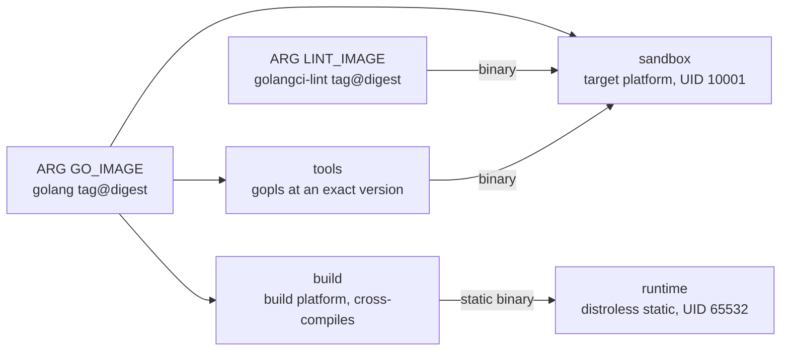

# A pinned two-target container image pattern for the Go stacks

**Status:** accepted · 2026-11-20

> **Amended 2026-11-20 (agentic_template_start-49o).** `forge upgrade` now delivers the Go stacks'
> `Dockerfile`, `.dockerignore` and `CONTAINER.md`, which replaces the "Deferred" alternative and
> the consequence that repos "do not receive these files" below. They are added **only if
> missing**, for a repo whose `.forge/manifest.json` names `go-cli-cobra`, `go-api-chi` or
> `go-web-templ` (a repo with no manifest or an empty `stack` is skipped; the stack is never
> guessed). If either `Dockerfile` or `.dockerignore` exists with content that is not forge's,
> nothing is added, because the shipped `.dockerignore` is an allowlist starting with `*` that
> would break a hand-written Dockerfile; an existing `CONTAINER.md` is never overwritten. A
> build-pair file byte-identical to the embedded one counts as forge's, so an upgrade interrupted
> partway is completed on retry; files are written by rename, `Dockerfile` last. Upgrade does **not** touch
> stack-overlay content: the `image`, `image:lint` and `image:scan` tasks, the `hadolint` and
> `trivy` pins, the CI scan step, and the `PORT`/`slog` application changes. It prints a notice
> saying so, and the Dockerfile's Go, golangci-lint (and templ) versions must be aligned with the
> repo's `mise.toml` by hand. Infrastructure version 10.

## Context

The Go stacks shipped no container image definition. A generated repo could be built and tested, but anyone who wanted to run it in a container, or hand it to an agent running in a sandbox, had to write a Dockerfile from scratch. The examples people reach for break rules forge already enforces elsewhere: tools installed with `@latest`, a Go version different from the stack's, a hardcoded `GOARCH`, a single stage, and a root user.

Two different images are wanted from the same repository:

- a **runtime** image that holds the application and nothing else;
- a **sandbox** image that holds the Go toolchain and shell tools, for agents and jobs that edit, build, and lint the code.

The Go server stacks were also not Twelve-Factor apps: the port was hardcoded to `:8080`, and logs were unstructured text. A minimal image around such an app would still need a rebuild to change its port.

The constraints are the existing invariants: `forge init` works offline, generated repos work without `forge` installed, versions are pinned exactly, and local gates and CI converge on `mise run ci` (ADR-0003). ADR-0021 established that Docker is optional for a generated repo.

This ADR defines an image pattern only. Registries, clusters, schedulers, and deployment are out of scope.

## Decision

Every Go stack (`go-cli-cobra`, `go-api-chi`, `go-web-templ`) ships a `Dockerfile`, a `.dockerignore`, and a `CONTAINER.md` at the root of its overlay.

**One Dockerfile, two targets.** `runtime` is the last stage, so a plain `docker build .` produces the application image. `sandbox` is selected with `--target sandbox`. Both start from the same pinned Go image, declared once as `ARG GO_IMAGE`. They are separate stages because the sandbox must be native to the target platform while the build stage runs on the build platform and cross-compiles.

**Pinning.** Every image, including the `# syntax=` frontend, is written `tag@sha256:digest`. The tag is documentation; the digest is what is pulled. Digests are multi-platform index digests, so one pin serves `linux/amd64` and `linux/arm64`. Every stage's `FROM` refers to one of the pinned `ARG`s, so no stage can introduce an unpinned image. The Go and golangci-lint versions equal the stack's `mise.toml` pins, and a test enforces that. gopls is an exact module version, verified by the Go checksum database.

This departs from the position recorded in Beads issue `agentic_template_start-3xw.23`, which left image digests unpinned. That position still stands for the OTel Compose images; a tag can be re-pointed, and an image we ship as a pattern for production use should not depend on that.

> **Amended 2026-11-20 (agentic_template_start-1w3).** The OTel Compose images are now digest-pinned
> too, so the sentence above that this position "still stands for the OTel Compose images" no
> longer holds. `templates/common/otel/compose.yaml` writes `busybox`, the Aspire dashboard and the
> Collector as `tag@sha256:<multi-platform index digest>`, and `TestOtelComposeImagesPinnedByDigest`
> enforces the shape. Moving a Compose image is now a deliberate digest change plus an infra
> version bump (the file is upgrade-managed), the same as any other pin.

**Alpine packages are not version-pinned.** Alpine removes superseded package versions from its repositories, so exact pins make a Dockerfile unbuildable within weeks. The digest-pinned base fixes the Alpine release, which bounds the drift. hadolint rule `DL3018` is ignored inline, with this reason.

**Platform is never hardcoded.** The build stage uses `--platform=${BUILDPLATFORM}` and sets `GOOS`/`GOARCH` from `TARGETOS`/`TARGETARCH`.

**Runtime target.** A static binary (`CGO_ENABLED=0`, `-trimpath`, stripped) on `gcr.io/distroless/static-debian13:nonroot`. It runs as numeric UID 65532, has an exec-form `ENTRYPOINT`, and contains no shell and no `RUN` instruction. It has no `HEALTHCHECK`, because there is no shell to run one and probing belongs to the platform. Server stacks add `ENV PORT=8080` and `EXPOSE 8080`.

**Generated code is regenerated in the build.** `go-web-templ` checks in `*_templ.go`, generated from `.templ` sources. Its build stage runs `templ generate` before `go build`, and `.dockerignore` re-includes `**/*.templ`, so a template-only edit reaches the image and invalidates the layer cache. The generator is pinned once as `ARG TEMPL_VERSION`, equal to the templ tool in `mise.toml` and the module in `go.mod`, and is installed in two stages: for the build platform (used by the build) and for the target platform (shipped in the sandbox).

**Sandbox target.** The Go image plus `bash`, `coreutils`, `curl`, `git`, `jq`, gopls, and golangci-lint. It runs as numeric UID 10001 in `/workspace` with `CGO_ENABLED=0`. It has no C compiler; `CONTAINER.md` documents how to add one.

**Twelve-Factor app code.** The two server stacks read their port from `PORT` (default `8080`) and write one JSON object per log line to stdout with `log/slog`. The existing `SIGTERM` drain and telemetry flush are unchanged. `CONTAINER.md` maps all twelve factors to what the repository does.

**Gates are mise tasks.**

| Task | Does | Needs Docker | Called by |
|---|---|---|---|
| `image:lint` | `hadolint Dockerfile` | No | `mise run ci` |
| `image` | Builds both targets | Yes | On demand; dependency of `image:scan` |
| `image:scan` | Trivy on the runtime image; fails on fixable HIGH or CRITICAL findings | Yes | A second step in `ci.yml` |

`mise run ci` stays free of Docker. The Go stacks' `ci.yml` gains one step, `mise run image:scan`, which still only delegates to mise.

**The build context is an allowlist.** `.dockerignore` excludes everything, then re-includes `go.mod`, `go.sum`, and Go sources (plus embedded static assets for `go-web-templ`).

## Considered Options

- **Runtime image only.** Rejected: the motivating use is agents working in a sandbox, and the sandbox costs almost nothing extra because the build needs the same pinned toolchain.
- **Two Dockerfiles.** Rejected: two files would pin the Go image twice and drift apart.
- **`scratch` as the runtime base.** Rejected: it needs CA certificates, timezone data, and a user entry copied in by hand. Distroless static provides those and is still about 2 MB.
- **Chainguard static.** Rejected for now: its free tier publishes only `latest`, so the pin would have no meaningful tag.
- **Putting build and scan inside `mise run ci`.** Rejected: it would make Docker mandatory for every local gate run and for the hermetic release tests, against ADR-0021.
- **Version-pinning apk packages.** Rejected, as explained above.
- **Leaving the app code alone.** Rejected: an image whose port is fixed at compile time is not configurable by environment.
- **Propagating the files with `forge upgrade`.** Deferred: upgrade copies only unrendered `templates/common/` files, and these files are stack-specific.

## Consequences

- A new Go repo can build a non-root runtime image of about 30 MB and a sandbox image of about 530 MB with `mise run image`.
- The Go stacks' `mise.toml` gains two exact-pinned tools, `hadolint` and `trivy`. `mise install` downloads them.
- CI for Go stacks needs a Docker daemon for the scan step. GitHub's `ubuntu-24.04` runners provide one.
- The scan gate reports advisories in indirect dependencies that `govulncheck` passes because the code never calls them. Introducing it required raising the `golang.org/x/net` pin from v0.60.0 to v0.62.0 in `go-api-chi` and `go-cli-cobra`.
- Pins are refreshed by hand, as everywhere else in forge. Changing the Go or golangci-lint version now means changing `mise.toml` and the `Dockerfile` together; `TestGoStackDockerfileToolVersionsMatchMise` fails if they differ.
- Code that used `*log.Logger` in the server stacks now uses `*slog.Logger`, and log output is JSON.
- Repos generated before this change do not receive these files from `forge upgrade`.
- A fullstack `go-api-chi` repo's image contains only the API. `web/` is excluded from the build context.
- `docker build` is not added to the agent allowlist, so agents are prompted before building.
