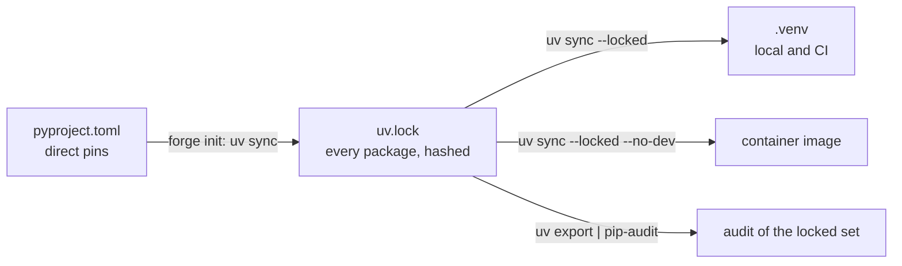

# Python stacks use uv with a committed lock

**Status:** accepted · 2026-11-21

## Context

The Python stacks (`python-cli-typer`, `python-fastapi`, `python-web-jinja`) installed their
dependencies with `pip install -e .[dev]` into the mise-managed interpreter. `pyproject.toml` pinned
direct dependencies with `==`, but nothing pinned transitive dependencies, so two installs of the
same commit could differ. `pip-audit` audited whatever happened to be installed.

That was tolerable for a local walking skeleton. It is not tolerable for a container image
(ADR-0026): an image built from an unlocked dependency set is not reproducible, and its
vulnerability scan can change result without a code change. The Go stacks get this from `go.sum`
and `go mod verify`; Python needs an equivalent.

`uv` is already the maintainer-side tool in `sources.yaml` (`uv init`, `uv add`), is already on the
agent allowlist, and is the tool the vendored Python guideline recommends for dependency
management.

## Decision

The three Python stacks use **uv** as their package manager and commit a **`uv.lock`**.

- **uv is an exact mise pin** in each Python stack's `mise.toml`, like every other tool.
- **Development dependencies are a dependency group.** `[project.optional-dependencies] dev`
  becomes `[dependency-groups] dev` (PEP 735). `uv sync` installs it by default and `--no-dev`
  leaves it out, which is what the image build needs.
- **The lock is generated at `forge init`, not shipped in the template.** `forge init` runs
  `mise exec -- uv sync` where it used to run `pip install -e .[dev]`; the resulting `uv.lock` is
  part of the initial commit. This is the same shape as `go mod tidy` for `go-api-chi` and
  `npm install` for the TypeScript stacks (ADR-0014). The lock contains the project name, which
  is a template variable, so a shipped lock would have to be a template of several hundred
  hashed entries per stack.
- **Tasks that need project packages run through `uv run`** (`uv run pytest`, `uv run pyright`).
  `uv run` creates or syncs `.venv` on demand, so the Lefthook gates work on a fresh clone
  without a separate install step.
- **`mise run ci` starts with `uv sync --locked`.** It fails when `uv.lock` does not match
  `pyproject.toml`, so a stale lock cannot reach `main`.
- **`pip-audit` stays the audit tool** (the guideline names it) and audits the locked set,
  exported from `uv.lock` with hashes, rather than the ambient environment.

## Considered Options

- **A hash-pinned `requirements.lock` beside pip.** Rejected by the user in favour of uv: it adds
  a second file to keep in step with `pyproject.toml` and a compile tool, and still leaves two
  ways to install.
- **Shipping `uv.lock` in the template.** Rejected: see above; it also could not be refreshed by
  `forge update`, which supports Go stacks only.
- **Activating `.venv` through mise (`_.python.venv`) and leaving task bodies unchanged.**
  Rejected: without the venv present mise only warns, so a fresh clone's hooks would fail with
  unresolved imports. `uv run` is self-healing.
- **Installing from `pyproject.toml` only.** Rejected: transitive dependencies float.

## Consequences

- A new Python repo has a hash-locked dependency set from its first commit.
- `forge init` for a Python stack needs `uv` (through mise) and network access, as it already
  needed pip and network access.
- Adding or bumping a dependency is `uv add` / `uv lock`; editing `pyproject.toml` by hand without
  re-locking fails `mise run ci`.
- The build backend (`hatchling`) stays an exact pin in `[build-system]`; uv does not lock build
  dependencies, so hatchling's own dependencies are not hash-locked.
- Repos generated before this change keep working with pip. `forge upgrade` does not rewrite
  `pyproject.toml` or `mise.toml`; moving an existing repo to uv is a manual step that
  `CONTAINER.md` describes.
