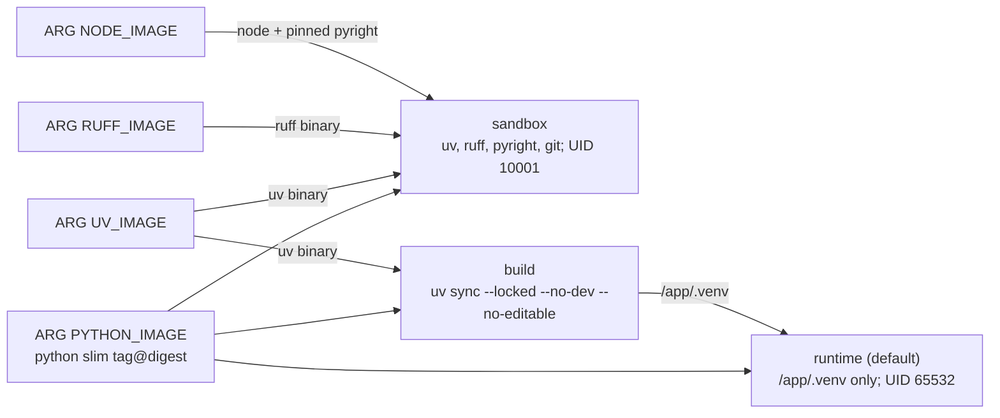

# A pinned two-target container image pattern for the Python stacks

**Status:** accepted · 2026-11-21

## Context

ADR-0023 gave the Go stacks a pinned, two-target container image pattern. The Python stacks had
none: no Dockerfile, a server bound to `127.0.0.1:8000` from a mise task, and unstructured logs.

The same two images are wanted — a **runtime** image holding the application and a **sandbox**
image holding the toolchain for agents — under the same invariants (exact pins, `mise run ci`
without Docker, generated repos that work without `forge`). ADR-0025 supplies the locked
dependency set this needs.

Python differs from Go in three ways that shape the decision: there is no static binary, so the
runtime needs an interpreter; wheels are platform-specific, so the build cannot cross-compile;
and the package directory name is a template variable, while `forge upgrade` can only deliver
files it can compare byte for byte.

This ADR defines an image pattern only. Registries, clusters and deployment are out of scope.

## Decision

Every Python stack (`python-cli-typer`, `python-fastapi`, `python-web-jinja`) ships a
`Dockerfile`, a `.dockerignore` and a `CONTAINER.md` at the root of its overlay. Everything
ADR-0023 decided applies unless stated otherwise here.

**Pins.** Four images, each `tag@sha256:<multi-platform index digest>` behind an `ARG`, plus the
`# syntax=` frontend already used by the Go stacks.

| ARG | Image | Must equal in `mise.toml` |
|---|---|---|
| `PYTHON_IMAGE` | `python:3.15.2-slim-trixie` | `python` |
| `UV_IMAGE` | `ghcr.io/astral-sh/uv:0.13.9` | `uv` |
| `RUFF_IMAGE` | `ghcr.io/astral-sh/ruff:0.17.5` | `ruff` |
| `NODE_IMAGE` | `node:26.13.1-trixie-slim` | `node` where the stack pins it |
| `ARG PYRIGHT_VERSION` | `1.1.414` (npm) | `npm:pyright` |

A test enforces each equality, as `TestGoStackDockerfileToolVersionsMatchMise` does for Go.

**The Dockerfile names no package.** It is a plain file with no template variables, so
`forge upgrade` can deliver it. Each stack declares a fixed console script named `app` in
`[project.scripts]`, and the runtime `ENTRYPOINT` is `["/app/.venv/bin/app"]` — the counterpart
of Go's `/app` binary. `.dockerignore` uses globs only.

**Runtime target.** `python:<version>-slim`, the same interpreter mise pins, not distroless:
distroless Python ships Debian's interpreter, which cannot match the pin. The stage copies
`/app/.venv` from the build stage and nothing else: no uv, no source tree, no build tools. The
project is installed non-editable, so templates and static files travel inside the wheel. It runs
as numeric UID 65532 with `PYTHONDONTWRITEBYTECODE=1` and `PYTHONUNBUFFERED=1`, works with a
read-only root filesystem and all capabilities dropped, and has no `HEALTHCHECK`. Unlike the Go
runtime it contains a shell.

**The runtime stage has one `RUN`.** It applies Debian security updates (`apt-get upgrade`) and
removes pip, setuptools and wheel from the base interpreter. The official Python image is rebuilt
less often than Debian publishes fixes, so on the day this was written the newest
`python:3.15.2-slim-trixie` digest already failed the scan gate on a fixed `zlib1g` advisory and
on libraries vendored inside pip. Without this step a freshly generated repo would fail
`mise run image:scan` with nothing in the repo to fix. The digest still fixes the Python build
and the Debian release; only Debian's security patches move with the build date. hadolint
`DL3005` is ignored inline with this reason.

**Build stage.** Runs on the **target** platform; there is no `BUILDPLATFORM` cross-compile,
because wheels are platform-specific. The platform is still never hardcoded. It copies
`pyproject.toml` and `uv.lock`, runs `uv sync --locked --no-dev --no-install-project`, then
copies the source and runs `uv sync --locked --no-dev --no-editable`. `--locked` verifies hashes
and fails on a stale lock; it is the `go mod download && go mod verify` of this pattern.
Bytecode is compiled at build time.

**Sandbox target.** The Python image plus `bash`, `curl`, `git`, `jq`, uv, ruff, and Node with
pyright at the exact mise version (`libatomic1` is installed because the copied Node binary
links against it). It runs as numeric UID 10001 in `/workspace` and never
downloads an interpreter (`UV_PYTHON_DOWNLOADS=never`). Debian packages are not version-pinned
for the reason ADR-0023 gives for Alpine; hadolint `DL3008` is ignored inline with that reason.

**Twelve-Factor app code.** The two server stacks gain a `serve` module whose `main()` is the
`app` console script. It reads `HOST` and `PORT` from the environment and writes one JSON object
per log line to stdout, including uvicorn's own logs.

| Setting | Default in code | Set by the image |
|---|---|---|
| `HOST` | `127.0.0.1` | `0.0.0.0` |
| `PORT` | `8000` | `8080` |

The code defaults are unchanged from before this ADR, so the frontend API default (ADR-0013)
still points at port 8000 locally. The image uses 8080 like the Go stacks. `mise run serve` runs
the same `app` entry point under `opentelemetry-instrument`; the container starts `app` directly
and the telemetry bootstrap installs its own providers (ADR-0020).

**Gates** are the three mise tasks of ADR-0023, unchanged: `image:lint` in `mise run ci`,
`image` on demand, `image:scan` as a second CI step.

**The build context is an allowlist.** Everything is excluded, then `pyproject.toml`, `uv.lock`,
`README.md` (the build backend reads it) and `**/*.py` are re-included; `python-web-jinja` also
re-includes `**/templates/**` and `**/static/**`. `.venv/`, `tests/` and `web/` are excluded
again afterwards.

**`forge upgrade` delivers the three files** under the rules of the ADR-0023 amendment:
add-if-missing, the build pair all-or-nothing, `CONTAINER.md` never overwritten, `Dockerfile`
written last, for a repo whose manifest names one of the three Python stacks. Infrastructure
version 11. For a repo generated before ADR-0025 the delivered Dockerfile does not build until
the repo has a `uv.lock` and an `app` console script; the upgrade notice and `CONTAINER.md` say
so.

## Considered Options

- **Distroless Python as the runtime base.** Rejected: its interpreter is Debian's, not the
  pinned one, so development and production would run different Python versions.
- **Distroless `cc` with CPython copied in.** Rejected: a hand-assembled interpreter layout that
  breaks across Python releases.
- **A templated `Dockerfile.tmpl` naming the package.** Rejected: `forge upgrade` compares raw
  embedded bytes, and `CONTAINER.md` contains literal `{{` that a template render would reject.
- **Binding `0.0.0.0` by default in code.** Rejected: it would widen the local development bind.
- **A runtime stage with no `RUN`, as in Go.** Rejected: the scan gate would fail on base-image
  findings the repo cannot fix, until upstream rebuilds the image.
- **Scanning only Python packages (`--pkg-types library`).** Rejected: it would hide real
  operating-system advisories in the image we ship as a pattern.
- **Leaving pyright out of the sandbox.** Rejected: `mise run lint` could not be reproduced in
  the sandbox. It costs a Node runtime.
- **Changing the local port to 8080.** Rejected: the frontend fragments default to 8000.

## Consequences

- A new Python repo can build a non-root runtime image and a sandbox image with `mise run image`.
- The Python stacks' `mise.toml` gains exact pins for `uv`, `hadolint` and `trivy`.
- CI for Python stacks needs a Docker daemon for the scan step.
- Changing the Python, uv, ruff or pyright version means changing `mise.toml` and the
  `Dockerfile` together; a test fails if they differ.
- Two builds of the same commit on different days can differ in Debian security patches in the
  runtime image. Everything else is fixed by digest and by `uv.lock`.
- Multi-platform builds need emulation for the non-native platform, because nothing is
  cross-compiled.
- A fullstack `python-fastapi` repo's image contains only the API; `web/` is excluded.
- `docker build` is still not on the agent allowlist.
