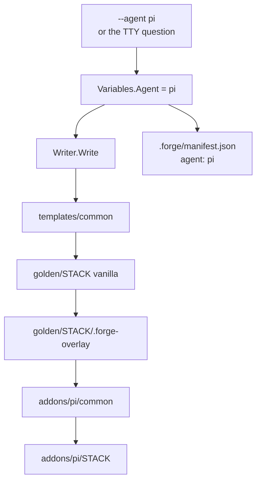

# Agent add-on dimension: an opt-in Pi layer for the Go api and cli stacks

**Status:** accepted · 2026-11-21 (agentic_template_start-589)

> **Superseded in part by ADR-0028 (2026-11-21).** `forge upgrade` now delivers the add-on to existing repos (`forge upgrade --agent pi`) and refreshes its wholly-owned files, and `mise run image:agent:scan` is a CI step for repos scaffolded with the add-on. The consequences below that say otherwise no longer hold. The rest of this ADR stands.

## Context

Go systems built from `go-api-chi` and `go-cli-cobra` should be able to run agentic flows: hand a prompt to a coding agent, let it work, and use the result. The agent wanted is [Pi](https://pi.dev) (`@earendil-works/pi-coding-agent`). The generated images contained no agent and no Node, and the generated Go code had no way to talk to one.

Three facts shaped the design:

- **Pi's SDK is TypeScript-only.** The CLI and the SDK are one npm package. For every other language Pi documents RPC mode: `pi --mode rpc`, a child process that exchanges JSON records over stdin and stdout.
- **Not every repo wants an agent.** Pi brings Node and its own JavaScript into an image. The `runtime` target of ADR-0023 is a 2 MB shell-less image, and that must stay the default.
- **forge had no opt-in concept.** Every stack has exactly one overlay (CONTEXT.md), `forge update` deletes everything under `templates/golden/<stack>/` except `.forge-overlay/`, and the only second tree `Writer.Write` composes is the frontend fragment of ADR-0013.

## Decision

`forge init` gains an **agent add-on**, selected with `--agent pi|none`, offered on `go-api-chi` and `go-cli-cobra`.

**An add-on is a template root of its own.** `templates/addons/<name>/common/` holds what every stack with the add-on receives; `templates/addons/<name>/<stack>/` holds the wiring for one stack. Both are composed after the stack overlay, with the same `copyTree` and the same rules (`.tmpl` renders, everything else is copied), so the add-on wins on a path collision. The catalog names which stacks offer which add-ons (`Stack.AgentAddons`).

The root sits outside `templates/golden/` so `forge update` never deletes it and the "one overlay per stack" rule still holds: an overlay is the opinions every repo of a stack gets, an add-on is a layer some repos ask for.

**The option defaults to off.** A given `--agent` is used as is. With a TTY and no flag, the question is asked after the frontend and api-base-url questions, with `none` preselected. With no TTY and no flag the answer is `none`. This is the one exception to the rule that a missing input without a TTY is an error (SPEC §6): the rule exists so a script cannot silently get a default it did not choose, and "no add-on" is what every existing script already gets. `--agent pi` on a stack that does not offer it is an error naming the stacks that do.

**Go talks to Pi through a scaffolded RPC client.** `internal/piagent` starts `pi --mode rpc --no-session`, correlates commands with responses by id, streams events to a callback, and returns when Pi emits `agent_settled`. It uses only the standard library. Cancellation never leaves a run unaccounted for: a cancelled prompt returns only after Pi confirms the run stopped, and when that cannot be established (no acknowledgement, or no confirmation within a grace period) the client kills Pi and the session reports `ErrTerminated`. Its tests re-execute the test binary as a fake Pi, so the walking skeleton keeps a real passing test that needs no Node, no Pi and no network. Because the package is plain Go under `templates/`, forge's own `go test ./...` runs those tests too.

Each stack gets one wired example, so the composed repo demonstrates the flow end to end:

| Stack | Wiring | Off by default |
|---|---|---|
| `go-api-chi` | `POST /agent/prompt`, mounted by one `{{ if .Agent }}` line in the overlay's router template | Yes: only when `PI_AGENT_ENABLED=1` |
| `go-cli-cobra` | An `agent` subcommand that registers itself in `init()` | No: it is a command the user runs |

The HTTP route is gated because it is unauthenticated and Pi can run shell commands. This is the same shape as the env-gated telemetry export of ADR-0020.

**Pi is installed by a second Dockerfile.** `Dockerfile.agent` adds two targets on top of the images ADR-0023 builds:

| Target | Base | Adds |
|---|---|---|
| `agent` | A digest-pinned Alpine Node image | The application binary copied from `app:runtime`, Pi, bash, git, ripgrep |
| `agent-sandbox` | `app:sandbox` | The Node binary, Pi, ripgrep |

Pi is pinned to an exact version and installed with `--ignore-scripts`. The Node image is `tag@sha256:digest`, at the Node version the other stacks pin, and is Alpine like the sandbox so one Node binary serves both targets. Pi's own container guide uses a Debian image; Pi was checked on this Alpine image before choosing it. `mise run image:agent` and `mise run image:agent:scan` live in `.config/mise/conf.d/pi.toml`, the route `otel.toml` already uses. The stacks' `image:lint` task becomes `hadolint Dockerfile*`, so the shared `mise run ci` gate lints `Dockerfile.agent` with no new CI step.

**The manifest records the add-on.** `.forge/manifest.json` gains `agent`, omitted when empty, so manifests of repos without an add-on are byte-identical to before and the schema version does not change.

## Considered Options

- **Adding the Pi stages to the stack `Dockerfile`.** Rejected: the file is copied verbatim, delivered byte-for-byte by `forge upgrade` (ADR-0023), and held to its shape by tests (`runtime` last, every `FROM` a pinned `ARG`). Making it a template would change upgrade delivery and those tests for every Go repo to serve an opt-in. The cost of the separate file is that Pi-in-the-sandbox is a derived image, `app:agent-sandbox`, not a change to `sandbox` itself.
- **Pi inside the `runtime` target.** Rejected: it would replace the distroless base with a Node image for everyone.
- **A per-stack add-on overlay under `templates/golden/<stack>/`.** Rejected: `forge update` deletes it, and it would duplicate the shared files across stacks, the duplication ADR-0013 rejected for frontend pairings.
- **A Node sidecar using the TypeScript SDK.** Rejected: it puts a Node project, a lockfile and Node gates into a Go repo to reach an API the RPC protocol already exposes.
- **Installing Pi and scaffolding no Go code.** Rejected: the composed repo would have no test proving the integration works, against ADR-0005.
- **Following the missing-flag rule strictly.** Rejected: every existing scripted `forge init` for the two stacks would start failing.
- **A plugin system.** Out of scope, as in the PRD. An add-on is embedded in the binary and vetted like an overlay; nothing is loaded at run time.

## Consequences

- `Writer.Write` now composes more trees than ADR-0013 recorded ("at most two"): common, vanilla, overlay, the optional frontend fragment, then the optional add-on's two trees. That consequence of ADR-0013 is superseded here.
- `Dockerfile.agent` builds `FROM` locally tagged images, so it needs the default `docker` build driver and `mise run image` first; `image:agent` depends on it.
- `image:agent:scan` exists but is not a CI step. Node base images carry findings a Go team cannot fix; teams that ship the `agent` image should add the step. (Superseded by ADR-0028: it is now a CI step for repos with the add-on; a team may remove it.)
- The Pi version and one Node digest are new pins to refresh; `AGENT.md` in the generated repo says how.
- `forge upgrade` does not deliver the add-on to existing repos, and does not refresh its files. Both are follow-up work the manifest field makes possible. (Superseded by ADR-0028.)
- Pi is not added as a harness target: the generated repo's guard hook, allowlists and skills still cover Claude Code, Codex and OpenCode only. Pi has no permission prompts; its boundary is the container.
- Other stacks can offer the add-on by listing it in the catalog and adding a `templates/addons/pi/<stack>/` tree. `TestPiAddonStacksMatchTheCatalog` fails until the tests cover the new stack.
