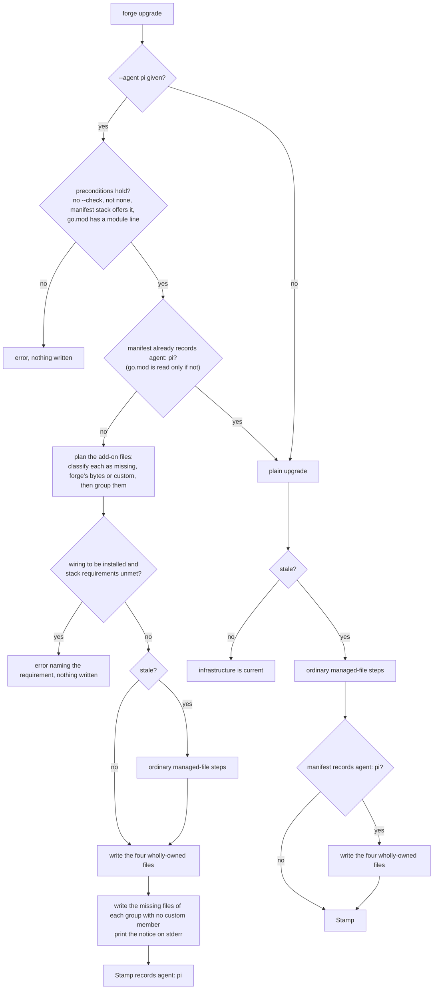

# forge upgrade delivers and refreshes the agent add-on

**Status:** accepted · 2026-11-21 (agentic_template_start-dbr) · follows ADR-0027, supersedes it in part (upgrade out of scope; `image:agent:scan` not a CI step)

## Context

ADR-0027 added the opt-in Pi agent add-on and left `forge upgrade` out of scope. Two gaps followed:

- **A repo cannot opt in later.** `--agent pi` exists only on `forge init`, and init needs an empty directory (ADR-0008). A team that wants the add-on after the first commit has to copy the files by hand.
- **The pins never refresh.** `Dockerfile.agent` pins the Node image digest and the Pi version, and `internal/piagent` is a client that will get fixes. A repo scaffolded with the add-on keeps the bytes it was born with. The pins exist to be refreshed (ADR-0023), and nothing refreshes them here.

The manifest already records `agent` (ADR-0027), so upgrade knows which repos have the add-on. What it does not know is the module path, which the wiring files need. The manifest does not record it, and ADR-0017 forbids guessing params.

## Decision

`forge upgrade` acts on the add-on in two ways. A repo whose manifest records `agent: pi` has its wholly-owned add-on files refreshed on every stale upgrade. `forge upgrade --agent pi` adds the add-on to a repo that does not have it.

**Four files are wholly-owned by the add-on.** `Dockerfile.agent`, `.config/mise/conf.d/pi.toml`, `internal/piagent/client.go` and `internal/piagent/client_test.go` are byte-copied from the embedded add-on, unconditionally, like the other wholly-owned files (SPEC §3.1). The copy overwrites local edits and restores a deleted file. The four files are hash-pinned alongside the existing managed files, so any change to them forces an `upgrade.Version` bump. That bump is how new Pi and Node pins and client fixes reach existing repos. A team that needs different pins sets the Docker build args `NODE_IMAGE` and `PI_VERSION` instead of editing the file.

**Refresh runs on every stale upgrade of a repo that records the add-on.** It needs no flag. A repo that does not record the add-on gets none of these files. A manifest that records an add-on this forge does not know, or one its stack no longer offers, is skipped silently and the field is kept, so a routine upgrade never fails on it.

**`--agent pi` opts a repo in.** Preconditions are checked before any write, and failing one is an error that writes nothing:

- `.forge/manifest.json` exists and names a stack the catalog offers the add-on for (`go-api-chi`, `go-cli-cobra`).
- `go.mod` has a `module` line. The module path is read from there because the manifest does not record it.
- `--agent` is not combined with `--check`.
- The value is not `none`. Removing an add-on is out of scope.
- The manifest does not record a different add-on. Upgrade does not switch add-ons.

An opt-in run works on a repo that is already current. If the repo is stale, the ordinary managed-file steps run too. Before the first write it plans the add-on files: it renders them, classifies each, groups them and checks the stack requirements. It then writes the four wholly-owned files, then `AGENT.md` (rendered with the stack) and the stack wiring (rendered with the module path) as the groups below allow. After opt-in these files are the user's code: later upgrades never write them, even if deleted. `scaffold.RenderAddon` serves both init and upgrade, so the delivered bytes equal what `forge init --agent pi` writes. `Stamp` runs last and records `agent: pi`, so an interrupted opt-in is finished by re-running the same command: files that already hold forge's bytes count as delivered. Opt-in on a repo whose manifest already records the add-on behaves as a plain upgrade, and `go.mod` is not read. A repo with no manifest is refused; opt-in does not backfill one.

| Add-on file | Class | Written by upgrade |
|---|---|---|
| `Dockerfile.agent` | Wholly-owned (add-on) | Every stale upgrade of a repo with the add-on, and at opt-in |
| `.config/mise/conf.d/pi.toml` | Wholly-owned (add-on) | Same |
| `internal/piagent/client.go`, `client_test.go` | Wholly-owned (add-on) | Same |
| `AGENT.md` | Add-on, delivered at opt-in | Only at opt-in, only if missing (a group of one) |
| `internal/httpapi/agent.go`, `agent_test.go` (api) · `cmd/agent.go`, `agent_test.go` (cli) | Add-on, delivered at opt-in | Only at opt-in, as a pair: both written when neither is custom, neither when either is |
| `mountAgent(router, logger)` in `internal/httpapi/router.go` (api), `image:lint` in `mise.toml`, the `image:agent:scan` step in `.github/workflows/ci.yml` | Stack overlay content, not delivered | Never; named in a stderr notice |

**Wiring and its tests travel as a pair.** Among the files delivered at opt-in (everything except the four wholly-owned files), a Go source file and its `_test.go` sibling in the same directory form a group. Any other file (`AGENT.md`) is a group of one. Each file is classified as one of:

- **missing**: nothing at the path.
- **forge's bytes**: byte-identical to what forge renders for this repo.
- **custom**: any other content, a symlink or a directory.

If any member of a group is custom, nothing from that group is written. Otherwise the missing members are written. Forge's bytes count as already delivered, which is how an interrupted opt-in completes on re-run. The reason: forge's `agent_test.go` tests forge's implementation and references forge's own identifiers, so installing it beside a custom `agent.go` would break `go test ./...`. This is the same all-or-nothing stance upgrade takes for `Dockerfile` + `.dockerignore` (ADR-0023).

**Forge's wiring needs things from the repo's own stack code.** Each add-on stack declares its requirements next to its owned files. They are checked by parsing the repo's Go source, before any write:

| Stack | Requirement | Guidance |
|---|---|---|
| `go-api-chi` | `internal/httpapi` declares `NewRouter` taking a `*slog.Logger` | Move the router and handlers to `log/slog`, then re-run |
| `go-cli-cobra` | package `cmd` declares `rootCmd` | Name the root command `rootCmd`, or write your own `cmd/agent.go` |

A requirement is checked only when forge's wiring for that stack would be installed. A repo that keeps its own wiring is not held to it. A failed requirement is an error naming the requirement and what to change. Nothing is written, including the ordinary managed files of a stale repo, and the manifest is unchanged. The check exists because `go-api-chi` repos scaffolded before the move to `log/slog` have `NewRouter(logger *log.Logger)`, and forge's `agent.go` and `agent_test.go` need a `*slog.Logger`.

**A notice names what upgrade did and did not do.** Opt-in prints it on stderr, built from what the run did: what was added; for each kept group, that the user's file was kept and which companion was not installed; then the stack's manual steps. These steps are stack overlay content that upgrade never edits (the stance of the container notice in ADR-0023):

- `go-api-chi`: add `mountAgent(router, logger)` to `internal/httpapi/router.go`. This step is listed only when forge's `internal/httpapi/agent.go` is in place. Until it is added the route is not mounted and lint reports `mountAgent` as unused.
- Both stacks: make sure `image:lint` runs `hadolint Dockerfile*` in `mise.toml`, so `Dockerfile.agent` is linted. Repos scaffolded since ADR-0027 already have it.
- Both stacks: add the CI step `mise run image:agent:scan` to `.github/workflows/ci.yml`.

**`image:agent:scan` is a CI step for repos scaffolded with the add-on.** The two stacks' overlay `ci.yml` became `ci.yml.tmpl` with a `{{ if .Agent }}` step. A repo without the add-on gets a `ci.yml` byte-identical to before. The trade-off from ADR-0027 stays true: Node base images can carry findings a Go team cannot fix. A team may remove the step.

**`upgrade.Version` goes from 11 to 12.**

## Considered Options

- **Add-if-missing for `Dockerfile.agent`, like the stack `Dockerfile` (ADR-0023).** Rejected: the pins would never refresh once the file exists, and refreshing them is the point of this change.
- **Refresh only when the file is byte-identical to a previously shipped version.** Rejected: it needs a history of hashes, maintained on every pin change, and a repo with any local edit would fall out of refresh silently.
- **Per-file add-if-missing for the wiring.** Rejected: it pairs a custom implementation with tests written for forge's, and the repo stops compiling its tests.
- **Delivering wiring adapted to each older stack API.** Rejected: it would need a second copy of the wiring per historical API, and the notice's manual steps would differ per era. A preflight with guidance keeps one wiring.
- **Re-delivering the stack wiring and `AGENT.md` on every upgrade.** Rejected: it would resurrect code a team deliberately deleted or rewrote.
- **Editing `router.go`, `mise.toml` or `ci.yml` in place.** Rejected: they are hand-edited stack overlay content with no ownership class. Upgrade names them in a notice instead, as it does for the container files (ADR-0023).
- **Recording the module path in the manifest.** Rejected: `go.mod` is already the authoritative record and cannot go stale.
- **Keeping `image:agent:scan` out of CI.** Rejected: the owner chose to gate the shipped agent image by default.

## Consequences

- Local edits to the four wholly-owned add-on files are lost on the next stale upgrade. Pin changes go through `NODE_IMAGE` and `PI_VERSION`.
- `upgrade.Version` is 12. Any later change to one of the four files needs another bump, because they are hash-pinned.
- The manual steps in the notice are the user's to do. Until they are done, the api route is unmounted and `Dockerfile.agent` is not linted.
- This supersedes two ADR-0027 consequences: "`image:agent:scan` exists but is not a CI step" and "`forge upgrade` does not deliver the add-on to existing repos, and does not refresh its files".
- Removing an add-on from a repo is still unsupported.
- An older `go-api-chi` repo must move to `log/slog` before it can opt in.
- A new add-on stack must declare its requirements alongside its owned files.
- Another add-on or stack must declare its owned files in `internal/upgrade` for upgrade to refresh them. Listing the add-on in the catalog is not enough.
