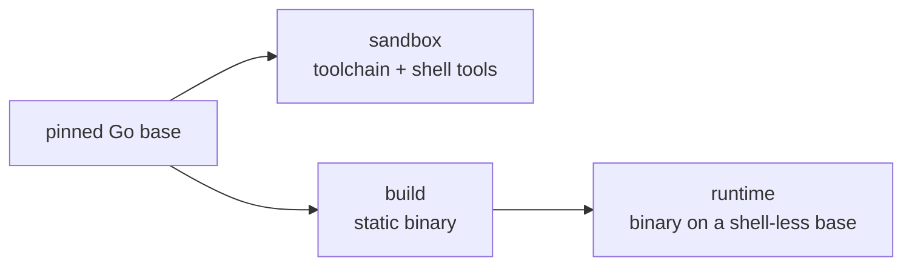

# Container images

This repository ships one `Dockerfile` that builds two images from a single pinned Go toolchain. It defines the images only; where they run (registry, cluster, scheduler) is deliberately out of scope.



| Target | Contents | Runs as | Use it for |
|---|---|---|---|
| `runtime` (default) | The static binary on distroless, no shell | UID 65532 | Running the application |
| `sandbox` | Go, gopls, golangci-lint, bash, git, curl, jq, coreutils | UID 10001, in `/workspace` | Agents and jobs that edit, build, and lint this code |

## Commands

| Command | What it does | Needs Docker |
|---|---|---|
| `mise run image:lint` | Lints the `Dockerfile` with hadolint; part of `mise run ci` | No |
| `mise run image` | Builds `app:runtime` and `app:sandbox` | Yes |
| `mise run image:scan` | Builds, then fails on fixable HIGH or CRITICAL findings in the runtime image | Yes |

Set `IMAGE` to change the image name and `PLATFORM` to cross-build:

```sh
IMAGE=registry.example.com/team/app PLATFORM=linux/arm64 mise run image
```

Nothing in the `Dockerfile` names a CPU architecture. The build stage runs on the build machine and cross-compiles, so an arm64 runtime image builds quickly on an amd64 host. Cross-building the `sandbox` target runs under emulation and needs QEMU registered with Docker.

## Running

```sh
docker run --rm app:runtime --help
```

The binary is the entrypoint, so arguments after the image name go straight to the CLI.

## Twelve-Factor compliance

| Factor | How this repository meets it |
|---|---|
| Codebase | One repository, one image definition |
| Dependencies | `go.mod` and `go.sum`, verified with `go mod verify` during the build; every base image pinned by digest |
| Config | Read from the environment (`OTEL_*`) and command-line flags; nothing is baked into the image |
| Backing services | The telemetry collector is attached by URL through `OTEL_EXPORTER_OTLP_ENDPOINT` |
| Build, release, run | The build stage produces an immutable image; configuration is added only at run time |
| Processes | One stateless process; keep state in a backing service, not on the container filesystem |
| Port binding | Not applicable: the CLI opens no port. A server command you add should bind to `PORT` |
| Concurrency | Scale by running more containers |
| Disposability | Starts in milliseconds; `SIGTERM` drains requests and flushes telemetry within 10 seconds |
| Dev/prod parity | `sandbox` and `runtime` are built from the same pinned toolchain |
| Logs | Output goes to stdout and errors to stderr; nothing is written to log files |
| Admin processes | Run one-off commands in the same image and environment as the application |

## Refreshing the pins

Every image is written as `tag@sha256:digest`. The tag documents the version; the digest is what Docker pulls. To move to a new version, change the tag and replace the digest with the one this prints:

```sh
docker buildx imagetools inspect golang:1.27.4-alpine3.24 --format '{{.Manifest.Digest}}'
```

- Use the digest of the multi-platform index, as printed above, so one pin serves amd64 and arm64.
- Keep the Go and golangci-lint versions equal to the ones in `mise.toml`.
- `GOPLS_VERSION` is an exact Go module version, checked against the Go checksum database.
- Alpine packages are not version-pinned, because Alpine removes superseded versions and exact pins break rebuilds. The digest fixes the Alpine release.

## Extending the sandbox

The sandbox sets `CGO_ENABLED=0` and has no C compiler. For cgo dependencies, add `build-base` to the `apk add` line and unset `CGO_ENABLED`.
