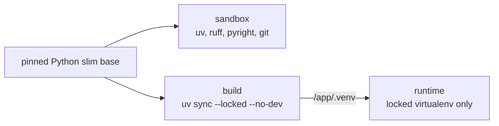

# Container images

This repository ships one `Dockerfile` that builds two images from a single pinned Python toolchain. It defines the images only; where they run (registry, cluster, scheduler) is deliberately out of scope.



| Target | Contents | Runs as | Use it for |
|---|---|---|---|
| `runtime` (default) | The locked virtualenv at `/app/.venv` on slim Python; no uv, no source tree, no build tools | UID 65532 | Running the application |
| `sandbox` | Python, uv, ruff, Node with pyright, bash, git, curl, jq | UID 10001, in `/workspace` | Agents and jobs that edit, lint, and test this code |

Debian security updates are applied when the `runtime` image is built, because the pinned base image lags them, and pip is removed from its interpreter because the runtime never installs anything. The digest still fixes the Python build and the Debian release.

The `runtime` image is slim Python rather than distroless, so it contains a shell: distroless ships Debian's interpreter, which cannot match the Python version pinned in `mise.toml`.

## Commands

| Command | What it does | Needs Docker |
|---|---|---|
| `mise run image:lint` | Lints the `Dockerfile` with hadolint; part of `mise run ci` | No |
| `mise run image` | Builds `app:runtime` and `app:sandbox` | Yes |
| `mise run image:scan` | Builds, then fails on fixable HIGH or CRITICAL findings in the runtime image | Yes |

Set `IMAGE` to change the image name and `PLATFORM` to build for another platform:

```sh
IMAGE=registry.example.com/team/app PLATFORM=linux/arm64 mise run image
```

Nothing in the `Dockerfile` names a CPU architecture, but nothing is cross-compiled either: wheels are platform-specific, so every stage runs on the target platform. Building for a non-native platform runs under emulation and needs QEMU registered with Docker.

## Running

```sh
docker run --rm -p 8000:8080 app:runtime
curl localhost:8000/health
```

The server binds the address in `HOST` and the port in `PORT`, writes JSON logs to stdout, and exits cleanly on `SIGTERM`. The image has no `HEALTHCHECK`; point your platform's probe at `/health`.

| Setting | Default in code | Set by the image |
|---|---|---|
| `HOST` | `127.0.0.1` | `0.0.0.0` |
| `PORT` | `8000` | `8080` |

The code defaults keep local development on loopback port 8000. The image sets `HOST` and `PORT` so the container is reachable and matches the Go stacks; override them at run time with `-e`, never by rebuilding.

## Dependencies

Dependencies are locked in `uv.lock`, which is committed. The build runs `uv sync --locked --no-dev --no-editable`, which fails if the lock is stale or a hash does not match.

- Add or change a dependency with `uv add <package>` (or edit `pyproject.toml` and run `uv lock`), then commit `uv.lock`.
- Development tools live in `[dependency-groups] dev` and are left out of the image.
- The project is installed non-editable, so everything the application needs travels inside the virtualenv.

## Twelve-Factor compliance

| Factor | How this repository meets it |
|---|---|
| Codebase | One repository, one image definition |
| Dependencies | `pyproject.toml` and the hash-locked `uv.lock`, enforced by `uv sync --locked` during the build; every base image pinned by digest |
| Config | Read from the environment (`HOST`, `PORT`, `OTEL_*`); nothing is baked into the image |
| Backing services | The telemetry collector is attached by URL through `OTEL_EXPORTER_OTLP_ENDPOINT` |
| Build, release, run | The build stage produces an immutable image; configuration is added only at run time |
| Processes | One stateless process; keep state in a backing service, not on the container filesystem |
| Port binding | Self-contained HTTP server bound to `HOST` and `PORT` |
| Concurrency | Scale by running more containers |
| Disposability | Starts in about a second; `SIGTERM` stops the server gracefully |
| Dev/prod parity | `sandbox` and `runtime` are built from the same pinned Python and the same lock |
| Logs | One JSON object per line on stdout, uvicorn's own logs included; routing them is the platform's job |
| Admin processes | Run one-off commands in the same image and environment as the application |

## Refreshing the pins

Every image is written as `tag@sha256:digest`. The tag documents the version; the digest is what Docker pulls. To move to a new version, change the tag and replace the digest with the one this prints:

```sh
docker buildx imagetools inspect python:3.15.2-slim-trixie --format '{{.Manifest.Digest}}'
```

- Use the digest of the multi-platform index, as printed above, so one pin serves amd64 and arm64.
- Keep the Python, uv, ruff, Node and pyright versions equal to the ones in `mise.toml`.
- `PYRIGHT_VERSION` is an exact npm version.
- Debian packages are not version-pinned, because Debian removes superseded versions and exact pins break rebuilds. The digest fixes the Debian release.

## Extending the sandbox

The sandbox has no C compiler, and `UV_PYTHON_DOWNLOADS=never` keeps it on the image's interpreter. For dependencies that compile native code, add `build-essential` to the `apt-get install` line.

## Repositories created before this pattern

If `Dockerfile`, `.dockerignore` and this file arrived through `forge upgrade` into a repository that used `pip install -e .[dev]`, the `Dockerfile` does not build until the repository has:

- A `uv.lock`: install uv and run `uv lock`, then commit the result.
- An `app` console script in `[project.scripts]` that starts the server, for example `app = "<package>.serve:main"`.
- The dev dependencies as `[dependency-groups] dev` instead of `[project.optional-dependencies] dev`.
- Server code that binds from `HOST` and `PORT` (defaults `127.0.0.1` and `8000`), so the image can set `0.0.0.0:8080`.
- The mise pins for `uv`, `hadolint` and `trivy`, and the `image:lint`, `image` and `image:scan` tasks, so `mise run image:lint`, `mise run image` and `mise run image:scan` work.
